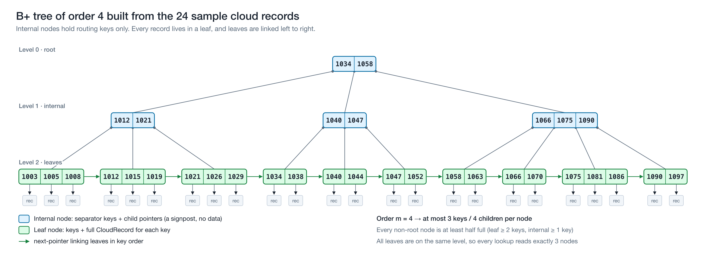
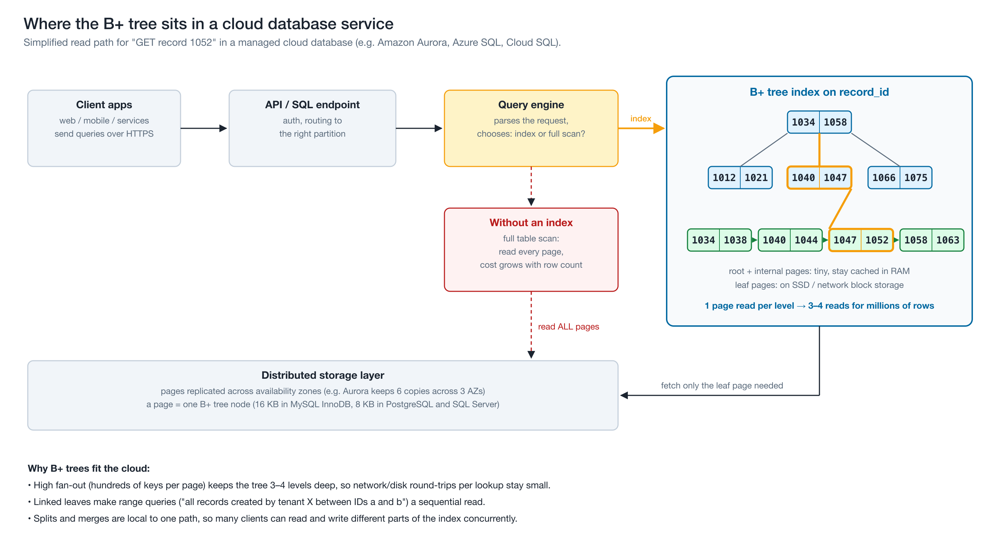
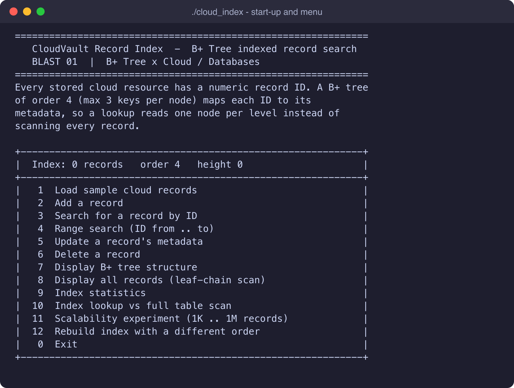
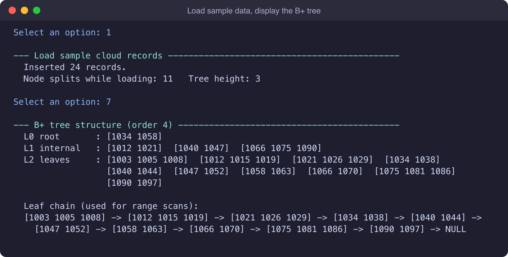
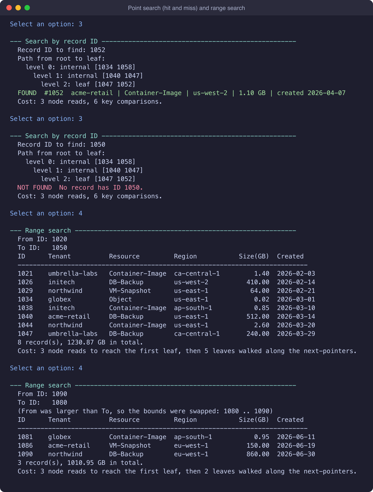
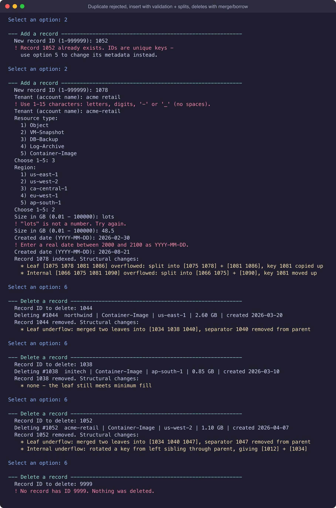
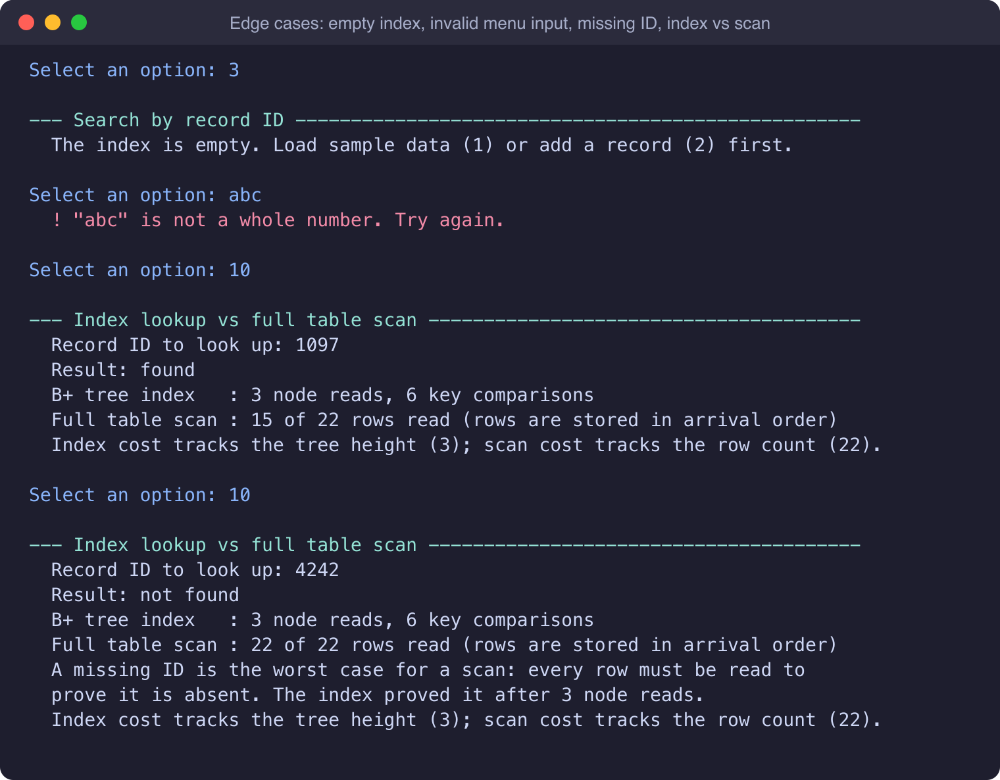
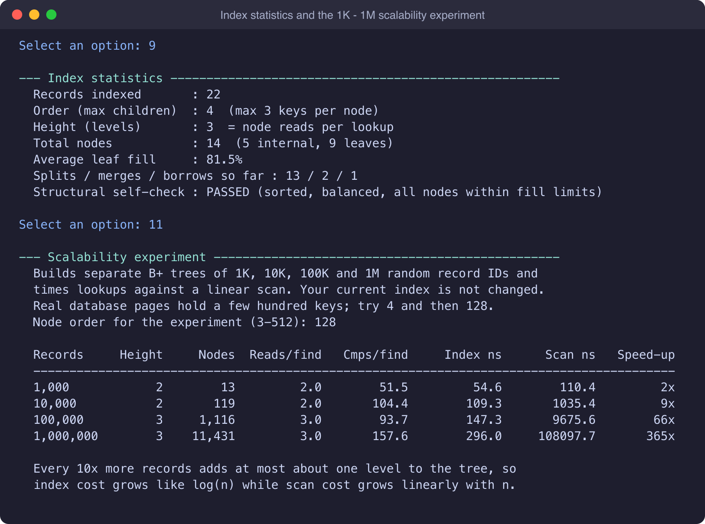
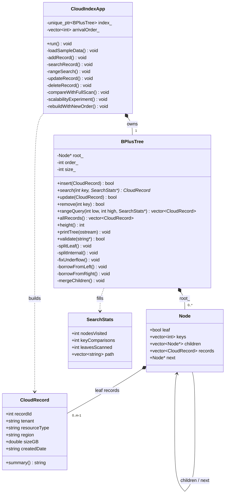

# BLAST 01 — B+ Tree Indexed Cloud-Record Search

**Name:** Pranav Anil Singh\
**Course:** CSC-6021 — Data Structures and Algorithms II\
**Instructor:** Dr. Victor Govindaswamy\
**Assigned topic:** B-Tree / B+ Tree  ·  **Emerging-technology area:** Cloud / Databases  ·  **Application:** Indexed cloud-record search

| Platform | Link |
|---|---|
| 📂 GitHub (this repo) | https://github.com/Pranavxoxo/BLAST01-BPlusTree-Cloud-Index |
| ▶️ YouTube presentation | *(add link after upload)* |
| 💼 LinkedIn post | *(add link after posting)* |

---

## What this project is

**CloudVault Record Index** is a menu-based C++ application that does what the index inside a cloud database does. Every stored cloud resource (an object, VM snapshot, database backup, log archive or container image) has a numeric record ID. A **B+ tree written from scratch** maps each ID to that resource's metadata, so lookups, range searches, inserts and deletes all take O(log n) instead of a scan through every record.

The program does more than return answers. It shows how the tree works as it runs:

* the exact root-to-leaf **search path** and its cost in node reads,
* every **leaf split, internal split, borrow, merge and root change** as it happens,
* the tree **level by level**, plus the **linked leaf chain**,
* a comparison of an **index lookup against a full table scan**,
* a **1K → 1M record scalability experiment** with timing.

The full research write-up is in [`docs/BLAST01-Report.md`](docs/BLAST01-Report.md), with a Word copy at [`docs/BLAST01-Report.docx`](docs/BLAST01-Report.docx). The slides used in the YouTube video are in [`docs/BLAST01-Video-Presentation.pptx`](docs/BLAST01-Video-Presentation.pptx).

---

## The data structure: B+ tree

A **B+ tree** is a balanced search tree where each node holds **many** sorted keys and has **many** children. In a database each node is one storage page, so the tree is very wide and very shallow.

* **Internal nodes** hold only separator keys and child pointers. They are signposts for routing a search.
* **Leaf nodes** hold the keys **and the records**, and each leaf points to the next one, so all data can be read in sorted order.
* **Order *m*** is the maximum number of children per node, so each node holds at most *m* − 1 keys. Every node except the root stays **at least half full**.
* **All leaves are at the same depth.** The tree only grows taller when the root splits.



| Operation | Cost (node / page reads) | How it works |
|---|---|---|
| Search | O(log_m n) | One node per level, root to leaf |
| Range search (k results) | O(log_m n + k/m) | Descend once, then follow leaf `next` pointers |
| Insert | O(log_m n) | Insert into a leaf; on overflow split it and **copy** the first key up; internal overflow **moves** the middle key up |
| Delete | O(log_m n) | Remove from the leaf; on underflow **borrow** from a sibling or **merge** with one |
| Ordered listing | O(n) | Walk the leaf chain |
| Space | O(n) | Nodes are 50–100% full |


More diagrams: [insert with cascading split](docs/diagrams/png/03-insert-leaf-and-internal-split.png) · [delete with merge and borrow](docs/diagrams/png/04-delete-merge-and-borrow.png) · [B-tree vs B+ tree](docs/diagrams/png/05-btree-vs-bplus-tree.png)

---

## Connection to Cloud / Databases

Cloud databases store their data on network-attached storage, and every page read is a round trip. A B+ tree keeps the number of round trips per lookup tiny:

* **High fan-out.** One node is one page (16 KB in MySQL InnoDB, 8 KB in PostgreSQL and SQL Server) and holds hundreds of keys. A table of 100 million rows is only about 3–4 levels deep.
* **Hot upper levels.** The root and internal nodes are about 1% of the index, so they stay cached in RAM. A typical lookup costs one storage read: the leaf.
* **Range queries.** Questions like "all of tenant X's backups between IDs a and b" become one descent plus a sequential scan of the leaves.

**Real systems that use it:** Amazon DynamoDB storage nodes keep each partition's data in a B-tree. Amazon Aurora runs the MySQL/PostgreSQL B+ tree indexes on top of a storage layer that keeps six copies across three availability zones. Azure SQL Database's rowstore indexes are B+ trees. SQLite stores all table data in the leaves of its B-trees. Sources are listed in the [References](#references).



---

## Build and run

Requires a C++17 compiler (g++ 7+, clang 5+, or MSVC 2017+). No external libraries.

**With make (macOS / Linux / WSL / MinGW):**

```bash
make            # builds ./cloud_index
make run        # builds and starts the interactive menu
make test       # builds and runs the automated test suite
make demo       # replays docs/demo-input.txt (the scripted demonstration)
```

**Without make:**

```bash
g++ -std=c++17 -Wall -Wextra -Iinclude src/*.cpp -o cloud_index
./cloud_index          # Windows: cloud_index.exe
./cloud_index 64       # optional: start with B+ tree order 64 (3-512, default 4)
```

The code compiles with no warnings under `-Wall -Wextra -pedantic`.

---

## Using the application

```
+------------------------------------------------------------+
|  Index: 24 records   order 4   height 3                    |
+------------------------------------------------------------+
|   1  Load sample cloud records                             |
|   2  Add a record                                          |
|   3  Search for a record by ID                             |
|   4  Range search (ID from .. to)                          |
|   5  Update a record's metadata                            |
|   6  Delete a record                                       |
|   7  Display B+ tree structure                             |
|   8  Display all records (leaf-chain scan)                 |
|   9  Index statistics                                      |
|  10  Index lookup vs full table scan                       |
|  11  Scalability experiment (1K .. 1M records)             |
|  12  Rebuild index with a different order                  |
|   0  Exit                                                  |
+------------------------------------------------------------+
```

Suggested first run: **1** (load 24 sample records) → **7** (see the tree) → **3** with ID `1052` → **4** from `1020` to `1050` → **2** to add ID `1078` and watch the splits → **6** to delete `1044` and watch the merge → **11** with order `128`.

### Sample execution (excerpt)

```
Select an option: 3
--- Search by record ID ---------------------------------------------------
  Record ID to find: 1052
  Path from root to leaf:
    level 0: internal [1034 1058]
      level 1: internal [1040 1047]
        level 2: leaf [1047 1052]
  FOUND  #1052  acme-retail | Container-Image | us-west-2 | 1.10 GB | created 2026-04-07
  Cost: 3 node reads, 6 key comparisons.

Select an option: 2
--- Add a record ----------------------------------------------------------
  New record ID (1-999999): 1078
  ...
  Record 1078 indexed. Structural changes:
    * Leaf [1075 1078 1081 1086] overflowed: split into [1075 1078] + [1081 1086], key 1081 copied up
    * Internal [1066 1075 1081 1090] overflowed: split into [1066 1075] + [1090], key 1081 moved up

Select an option: 6
--- Delete a record -------------------------------------------------------
  Record ID to delete: 1052
  Record 1052 removed. Structural changes:
    * Leaf underflow: merged two leaves into [1034 1040 1047], separator 1047 removed from parent
    * Internal underflow: rotated a key from left sibling through parent, giving [1012] + [1034]
```

The full transcript of the scripted demonstration is in [`docs/sample-output.txt`](docs/sample-output.txt).

### Scalability experiment (option 11, order 128, Apple M1 Max)

| Records | Height | Node reads / lookup | B+ tree ns / lookup | Linear scan ns / lookup | Speed-up |
|---|---|---|---|---|---|
| 1,000 | 2 | 2 | 55 | 110 | 2× |
| 10,000 | 2 | 2 | 109 | 1,035 | 9× |
| 100,000 | 3 | 3 | 147 | 9,676 | 66× |
| 1,000,000 | 3 | 3 | 296 | 108,098 | 365× |

1000× more data added only **one level** to the tree. At order 4, the same million records need **13** levels and lookups are about 3× slower. That is why real databases use wide nodes.

### Screenshots

| | |
|---|---|
|  |  |
|  |  |
|  |  |

These captures are rendered from the real output in `docs/sample-output.txt`.

### Validation and edge cases

Non-numeric or out-of-range menu input · duplicate IDs · searching, updating or deleting an ID that does not exist · operations on an empty index · reversed range bounds · tenant names with spaces · non-numeric sizes · impossible dates such as `2026-02-30` · deletes that cause merges and root collapse · end of input (Ctrl-D) · invalid command-line order. Each one produces a clear message, and none of them crash the program.

---

## Design (UML)




Activity diagram (menu loop and search algorithm): [`docs/diagrams/png/08-activity-diagram.png`](docs/diagrams/png/08-activity-diagram.png)

**Separation of concerns:** `BPlusTree` is a pure data structure with no input/output beyond printing itself. `CloudIndexApp` owns the menu and the scenario. All input is validated in one place (`InputUtils`).

---

## Testing

`make test` runs [`tests/test_bplustree.cpp`](tests/test_bplustree.cpp). It mirrors every operation in `std::map` and, after **every single** insert, delete or search, calls `validate()`. That method checks sorted keys, min/max fill, child counts, equal leaf depth, subtree key ranges, and the leaf chain. The tests cover orders 3–9 and 64, with 4,000 random operations each, plus targeted tests for an empty tree, duplicates, root split and collapse, and range queries.

```
Running B+ tree tests...
All tests passed.
```

---

## Repository structure

```
BLAST01-BPlusTree-Cloud-Index/
├── README.md
├── Makefile
├── include/
│   ├── BPlusTree.h          B+ tree interface + nested Node
│   ├── CloudRecord.h        record stored in the leaves
│   ├── CloudIndexApp.h      menu application
│   └── InputUtils.h         validated console input
├── src/
│   ├── BPlusTree.cpp        insert/split, search, range, delete/borrow/merge, validate
│   ├── CloudRecord.cpp
│   ├── CloudIndexApp.cpp    the 12 menu operations + sample data
│   ├── InputUtils.cpp
│   └── main.cpp
├── tests/
│   └── test_bplustree.cpp   randomized tests against std::map
├── tools/
│   └── make_diagrams.py     regenerates the SVG diagrams
└── docs/
    ├── BLAST01-Report.md    research / technical report (also .docx)
    ├── diagrams/            8 diagrams (SVG + PNG): structure, search, split, merge, B vs B+, cloud, UML, activity
    ├── screenshots/         terminal captures of the demo run
    ├── demo-input.txt       scripted input for `make demo`
    ├── sample-output.txt    full output of the demo run
    ├── test-output.txt
    ├── BLAST01-Video-Presentation.pptx   slides for the YouTube video (narration in speaker notes)
    ├── video-script.md      how to record + YouTube title/description
    └── linkedin-post.md     LinkedIn post draft
```

---

## References

1. Bayer, R., & McCreight, E. (1972). Organization and maintenance of large ordered indexes. *Acta Informatica, 1*(3), 173–189. https://doi.org/10.1007/BF00288683
2. Comer, D. (1979). The ubiquitous B-tree. *ACM Computing Surveys, 11*(2), 121–137. https://doi.org/10.1145/356770.356776
3. Cormen, T. H., Leiserson, C. E., Rivest, R. L., & Stein, C. (2022). *Introduction to Algorithms* (4th ed.), Ch. 18 "B-Trees". MIT Press.
4. Elhemali, M., et al. (2022). Amazon DynamoDB: A scalable, predictably performant, and fully managed NoSQL database service. *USENIX ATC '22*, 1037–1048. https://www.usenix.org/conference/atc22/presentation/elhemali
5. Lehman, P. L., & Yao, S. B. (1981). Efficient locking for concurrent operations on B-trees. *ACM TODS, 6*(4), 650–670. https://doi.org/10.1145/319628.319663
6. Microsoft. (2026). *Index architecture and design guide (SQL Server and Azure SQL)*. https://learn.microsoft.com/en-us/sql/relational-databases/sql-server-index-design-guide
7. Oracle. *The physical structure of an InnoDB index*, MySQL 8.0 Reference Manual. https://dev.mysql.com/doc/refman/8.0/en/innodb-physical-structure.html
8. PostgreSQL Global Development Group. *B-Tree indexes*. https://www.postgresql.org/docs/current/btree.html
9. Rodeh, O., Bacik, J., & Mason, C. (2013). BTRFS: The Linux B-tree filesystem. *ACM Transactions on Storage, 9*(3), 1–32. https://doi.org/10.1145/2501620.2501623
10. SQLite. *Database file format*. https://www.sqlite.org/fileformat2.html
11. Verbitski, A., et al. (2017). Amazon Aurora: Design considerations for high throughput cloud-native relational databases. *SIGMOD '17*, 1041–1052. https://doi.org/10.1145/3035918.3056101

---

*GitHub ↔ YouTube ↔ LinkedIn: this README links to the video and the post; the video description and the post link back here.*
