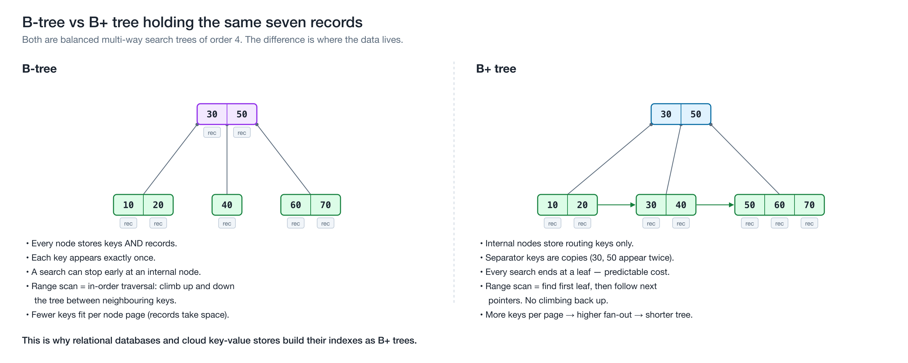
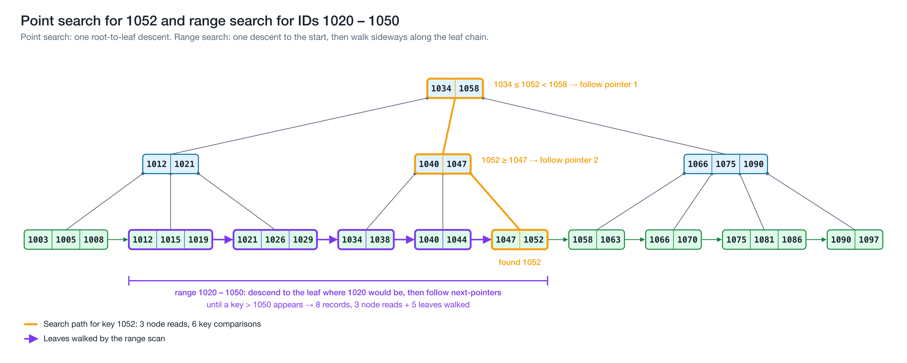
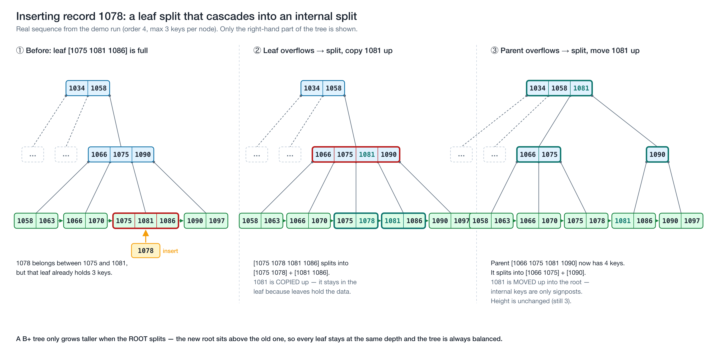
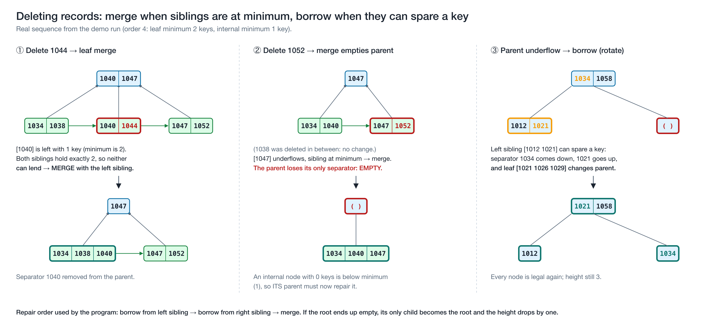
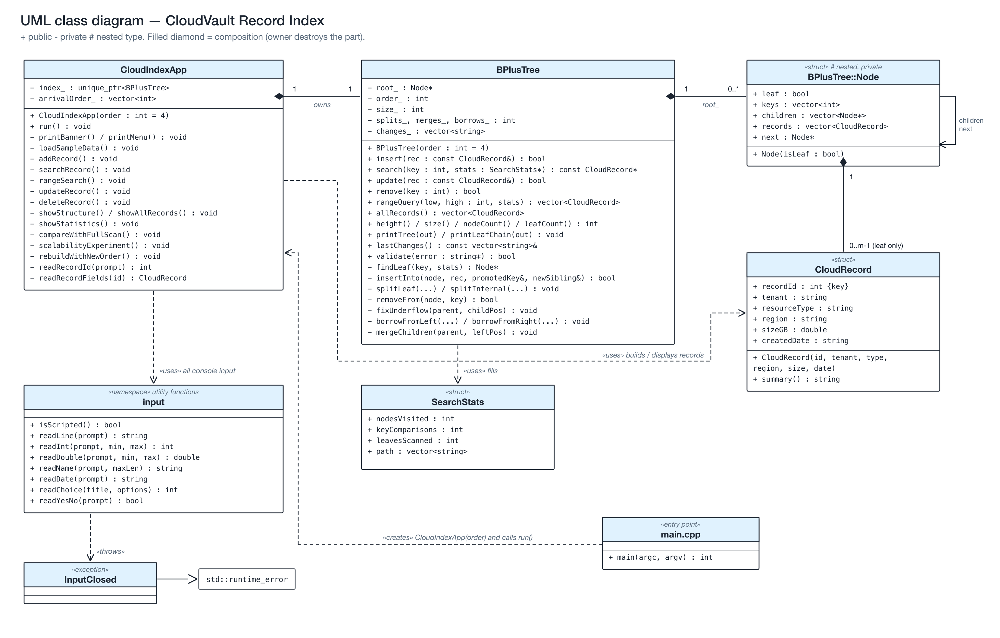
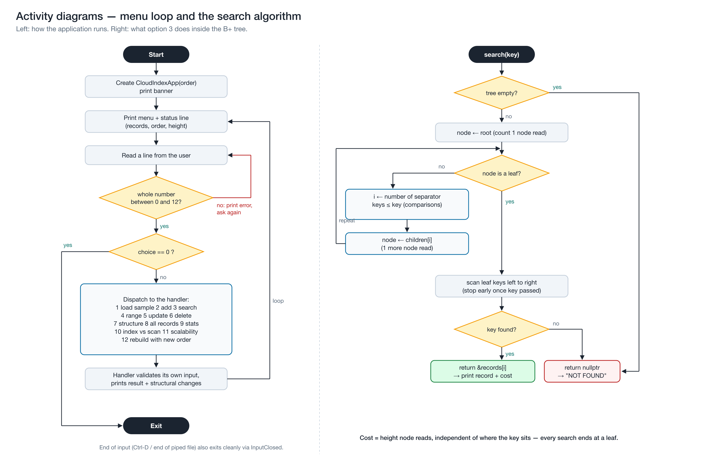

# BLAST 01: B+ Trees for Indexed Cloud-Record Search

**Name:** Pranav Anil Singh\
**Course:** CSC-6021 Data Structures and Algorithms II\
**Instructor:** Dr. Victor Govindaswamy\
**Assigned topic:** B-Tree / B+ Tree · Cloud / Databases · Indexed cloud-record search

| Link | URL |
|---|---|
| GitHub | https://github.com/Pranavxoxo/BLAST01-BPlusTree-Cloud-Index |
| YouTube | https://youtu.be/BAbp8Kh--b8 |
| LinkedIn | https://lnkd.in/p/gnaGYeny |

---

## 1. Introduction

A cloud provider may hold billions of records: object metadata, VM snapshots, database backups, customer rows. A user who asks for one of them by ID expects an answer in milliseconds. If the service has to read every record to find the right one, the time to answer grows with the size of the data set, and on network-attached storage every extra read is costly.

The **B+ tree** is the data structure that most databases use to avoid that. This report explains what a B+ tree is, how its operations work and what they cost, and why it suits cloud databases in particular. It then describes a menu-based C++ application, **CloudVault Record Index**, that uses a B+ tree written from scratch to index and search simulated cloud resource records.

---

## 2. What a B-tree and a B+ tree are

### 2.1 Definition

A **B-tree** is a self-balancing search tree in which every node can hold *many* keys and have *many* children, not just two. It was introduced by Bayer and McCreight (1972) for indexes too large to fit in main memory. The idea is to make each node as large as one disk page, so that reading one node fetches hundreds of keys at once. With hundreds of children per node, the tree stays very shallow.

A **B+ tree** is the variant of the B-tree that almost every database actually uses (Comer, 1979). It changes two things:

1. **All records are stored in the leaves.** Internal nodes keep only *separator keys* and child pointers. They act as signposts that route a search, and they hold no data.
2. **The leaves are linked together** in key order, so the whole data set can be read in sorted order by walking from leaf to leaf.

### 2.2 How the data is organised

A B+ tree has an **order** *m*, which is the maximum number of children a node may have. In this project:

| Rule | Order 4 (used in the demo) | General order *m* |
|---|---|---|
| Max keys in any node | 3 | *m* − 1 |
| Max children of an internal node | 4 | *m* |
| Min keys in a non-root leaf | 2 | ⌈(*m* − 1)/2⌉ |
| Min children of a non-root internal node | 2 | ⌈*m*/2⌉ |
| Root | may be less full than the minimum | at least 2 children if internal |
| Leaves | all at the same depth | all at the same depth |

Inside every node the keys are kept **sorted**. For an internal node with keys *k₀ < k₁ < … < kⱼ*, child *i* holds every key that is ≥ *kᵢ₋₁* and < *kᵢ*. That one rule is what lets a search discard all but one child at every level.


*Figure 1: The B+ tree the program builds from its 24 sample records (order 4). This shape is copied from the program's own output (menu option 7).*

The minimum-fill rule is what keeps the tree balanced. Every node except the root is at least half full, and all leaves sit on the same level. Because of that, the height can never grow much beyond log base ⌈*m*/2⌉ of *n*.

### 2.3 B-tree vs B+ tree



*Figure 2: The same seven keys in a B-tree and in a B+ tree.*

| | B-tree | B+ tree |
|---|---|---|
| Where records live | In every node | Only in leaves |
| Duplicate keys in the tree | None | Separator keys are copies of leaf keys |
| Search cost | Can stop early at an internal node | Always goes to a leaf, so the cost is predictable |
| Range / ordered scan | In-order traversal that climbs up and down the tree | Find the first leaf, then follow the `next` pointers |
| Keys per internal page | Fewer (records take space) | More, so fan-out is higher and the tree is shorter |

For a database index the B+ tree wins on both of the things that matter most: range queries are cheap, and internal nodes are small enough to stay cached in memory.

---

## 3. Operations

### 3.1 Search (point lookup)

Start at the root. In each internal node, find the first separator greater than the key and follow the pointer to its left; if no separator is greater, follow the last pointer. Repeat until you reach a leaf, then look for the key in that leaf. Every search reads exactly **one node per level**.

### 3.2 Range search

Search for the *low* end of the range to reach the correct leaf. From there, read keys left to right, following each leaf's `next` pointer, until a key passes the *high* end. The tree is descended **once**, however many records the range returns.



*Figure 3: Searching for 1052 reads 3 nodes. The range 1020–1050 descends once and then walks 5 linked leaves.*

### 3.3 Insertion and splitting

1. Search for the leaf where the new key belongs and insert it in sorted position.
2. If the leaf now has *m* keys (one too many), **split** it: the right half moves to a new leaf, the new leaf is linked into the chain, and its first key is **copied up** into the parent. The key stays in the leaf because leaves hold the data.
3. If the parent now overflows, split it too. For an internal node, the middle key is **moved up** (not copied), because internal keys are only signposts.
4. If the root splits, a new root is created above it. **This is the only way the tree gets taller**, and it adds a level above every leaf at once, so all leaves stay at the same depth.



*Figure 4: Inserting record 1078 in the demo run. The leaf split cascades into an internal-node split.*

### 3.4 Deletion, borrowing and merging

1. Remove the key from its leaf.
2. If the leaf is still at least half full, stop.
3. Otherwise, **borrow** a key from a neighbouring sibling that has more than the minimum, and update the separator in the parent.
4. If neither sibling can spare a key, **merge** the leaf with a sibling and remove their separator from the parent.
5. The parent may now be under-full in turn. It is repaired the same way: for internal nodes, borrowing *rotates* a key through the parent, and merging pulls the separator down.
6. If the root is left with no keys, its only child becomes the new root and the height drops by one.



*Figure 5: Deleting 1044 and then 1052 in the demo run: two leaf merges, then an internal-node borrow.*

A design note: when a deleted key also appears as a separator higher up, my implementation leaves that separator in place. Separators are only routing values, and the rule "left < separator ≤ right" still holds, so lookups stay correct. Many production engines are lazy about this in the same way, because rewriting separators would mean extra page writes.

### 3.5 Update and full listing

Changing a record's metadata without changing its key is a search plus an in-place overwrite, and the tree's shape does not change. Listing every record in order is a walk along the leaf chain.

---

## 4. Complexity

Let *n* = number of records, *m* = order (fan-out), *h* = height.

### 4.1 Height

Every non-root internal node has at least ⌈*m*/2⌉ children, so the number of leaves grows at least geometrically with height. That gives

> *h* = O(log₍⌈m/2⌉₎ *n*), and in practice *h* ≈ log_*m* *n*.

With a realistic page fan-out of *m* = 500, a 3-level B+ tree can index up to 500 × 500 × 499 ≈ **125 million** keys. A 4-level tree can index tens of billions.

### 4.2 Operation costs

| Operation | Node (page) reads | CPU comparisons | Notes |
|---|---|---|---|
| Search | *h* = O(log_*m* *n*) | O(*m* · log_*m* *n*), or O(log *n*) with binary search inside nodes | Always ends at a leaf |
| Range search returning *k* records | *h* + O(*k*/*m*) | O(log *n* + *k*) | One descent, then sequential leaves |
| Insert | O(log_*m* *n*) | O(*m* · log_*m* *n*) | At most one split per level |
| Delete | O(log_*m* *n*) | O(*m* · log_*m* *n*) | At most one borrow or merge per level |
| Update (same key) | *h* | same as search | Shape unchanged |
| Full ordered scan | *n*/*m* leaves | O(*n*) | Leaf chain only |

Splits and merges are **amortised O(1)** per operation: most inserts and deletes touch only one leaf.

### 4.3 Space

* O(*n*) overall. Leaves are 50–100% full, so they use between 1× and 2× the minimum space.
* Internal nodes add only about 1/*m* extra nodes on top of the leaves. With *m* = 128, a 1,000,000-record tree has about 11,400 nodes, of which only about 130 (roughly 1%) are internal.
* Each leaf stores one extra `next` pointer.

### 4.4 Measured results

Option 11 of the application builds trees of 1K, 10K, 100K and 1M random IDs and times 100,000 lookups against a linear scan. Results are from my machine (Apple M1 Max, clang `-O2`); absolute times will vary, but the trends will not.

**Order 128 (close to a real database page):**

| Records | Height | Nodes | Node reads / lookup | B+ tree ns / lookup | Linear scan ns / lookup | Speed-up |
|---|---|---|---|---|---|---|
| 1,000 | 2 | 13 | 2.0 | 55 | 110 | 2× |
| 10,000 | 2 | 119 | 2.0 | 109 | 1,035 | 9× |
| 100,000 | 3 | 1,116 | 3.0 | 147 | 9,676 | 66× |
| 1,000,000 | 3 | 11,431 | 3.0 | 296 | 108,098 | 365× |

**Order 4 (the small demo order):**

| Records | Height | Nodes | Node reads / lookup | B+ tree ns / lookup | Speed-up |
|---|---|---|---|---|---|
| 1,000 | 7 | 660 | 7.0 | 56 | 3× |
| 1,000,000 | 13 | 648,333 | 13.0 | 957 | 112× |

What the numbers show:

1. **Scan cost grows linearly.** Each 10× increase in records makes the scan about 10× slower.
2. **Index cost barely moves.** Going from 1,000 to 1,000,000 records (1000× more data) added only **one level** to the order-128 tree.
3. **Fan-out matters.** At 1M records, order 4 needs 13 node reads per lookup and order 128 needs 3. Order 128 does *more* key comparisons per lookup (158 vs 22) but is still **3× faster**, because comparing keys inside one node is cheap while jumping to another node causes a cache miss. On disk or cloud storage, each of those jumps would be a page read costing microseconds to milliseconds, so the gap would be far larger. This is exactly why databases size B+ tree nodes to match a storage page.

---

## 5. Advantages, limitations and when to use it

**Advantages**

* Guaranteed O(log *n*) search, insert and delete. There is no worst case where the tree degenerates into a list, as an unbalanced BST can.
* Very shallow, so few storage reads per lookup. This is the main advantage on disk, SSD and network storage.
* Excellent range queries and ordered scans through the leaf chain.
* Splits and merges are local to one root-to-leaf path, which makes concurrent access practical (Lehman & Yao, 1981).
* Predictable performance, because every lookup costs exactly *h* node reads.

**Limitations**

* More complex to implement than a BST or a hash table. Deletion with borrow and merge is the hardest part.
* Exact-match lookups in memory can be faster with a **hash table** (O(1) expected), but a hash table cannot answer range or ordered queries.
* Nodes are only 50–100% full, so some space is wasted.
* Writes update pages in place. For extremely write-heavy workloads, **LSM-trees** (used by Cassandra, RocksDB and Bigtable) batch writes better, at the cost of slower reads.
* For small data sets held entirely in memory, a balanced binary tree or a sorted array is simpler and just as fast.

**When it is the right choice:** large ordered data, stored on disk or network storage, with a mix of point lookups, range queries, inserts and deletes. That describes almost every database index.

---

## 6. Real-world applications

1. **Relational database indexes.** MySQL's InnoDB engine stores its indexes as B-trees whose records live in leaf pages, with a default page size of 16 KB (Oracle, n.d.). PostgreSQL's default index type is a multi-level B-tree in which each level can be read as a doubly-linked list of pages (PostgreSQL Global Development Group, n.d.). Microsoft's documentation for SQL Server and Azure SQL states that rowstore indexes are organized as B+ trees (Microsoft, 2026).
2. **Embedded databases.** SQLite, which ships inside every Android and iOS device and most browsers, stores each table as a B-tree whose interior pages hold only keys and child pointers, with *all data contained in the leaves*. That is a B+ tree (SQLite, n.d.).
3. **File systems.** Linux's Btrfs, whose name comes from "B-tree file system", keeps all of its metadata in copy-on-write B-trees (Rodeh, Bacik & Mason, 2013).
4. **Cloud key-value stores.** Inside Amazon DynamoDB, each storage node keeps its partition data in a B-tree alongside a replication log (Elhemali et al., 2022). This is covered in detail in the next section.

---

## 7. Connection to Cloud / Databases: indexed cloud-record search

### 7.1 The problem

A cloud database is used by thousands of tenants at once, holds huge amounts of data, and keeps its storage on a separate network service rather than on the server's local disk. Each storage read therefore crosses a network. The question "give me record 1052" has to be answered in a handful of reads, whether the table holds a thousand rows or a billion.


*Figure 6: Where the B+ tree sits in the read path of a managed cloud database.*

### 7.2 How the B+ tree solves it

* **High fan-out means few network round-trips.** One B+ tree node is one storage page (16 KB in InnoDB; 8 KB in PostgreSQL and SQL Server). A page holds hundreds of keys, so even very large tables are only 3–4 levels deep.
* **The top levels stay in RAM.** The root and internal levels are a tiny fraction of the index; in a 1M-record tree of order 128 they are only about 1% of the nodes. The database's buffer pool keeps them cached, so a lookup usually costs **one** storage read: the leaf.
* **Range queries match how cloud data is queried.** Billing, auditing and dashboards ask questions like "all of tenant X's backups between two IDs or dates". With a B+ tree that is one descent followed by a sequential scan of leaf pages.
* **Partitioning plus local B-trees.** Distributed databases split a table into partitions spread across many servers. Each partition is indexed by its own B-tree, so the work and the data scale out together.

### 7.3 Industry examples

* **Amazon DynamoDB.** AWS's fully managed NoSQL database. According to its USENIX ATC 2022 paper, each storage node stores its partition's data in a B-tree together with a write-ahead (replication) log, and the leader replica serves writes and strongly consistent reads (Elhemali et al., 2022).
* **Amazon Aurora.** A MySQL- and PostgreSQL-compatible cloud database. Its query engines keep the standard B+ tree indexes of those engines, but the pages live on a distributed storage layer that keeps six copies of the data across three availability zones (Verbitski et al., 2017).
* **Microsoft Azure SQL Database.** It runs the SQL Server engine, whose rowstore indexes are B+ trees of 8 KB pages (Microsoft, 2026).

### 7.4 How my application models this

**CloudVault Record Index** simulates the metadata index of a cloud storage service. Each `CloudRecord` describes one stored resource (tenant, resource type, region, size, creation date) and is keyed by a numeric `recordId`. The B+ tree plays the role of the database's primary-key index:

* Option 3 (search) shows the exact root-to-leaf path, which corresponds to the page reads.
* Option 4 (range search) shows the "one descent, then walk the leaves" pattern.
* Option 10 compares an index lookup with a **full table scan** over records stored in arrival order, the way rows sit in an unindexed heap table.
* Option 11 shows why fan-out matters at cloud scale (1M records, height 3).

The program is a simulation of the data structure, not a cloud service: it runs in memory on one machine.

---

## 8. Application design

### 8.1 Scenario and menu

| Option | What the user does | Data-structure operation |
|---|---|---|
| 1 | Load 24 sample cloud records | 24 × `insert` (causes 11 splits, height 3) |
| 2 | Add a record (validated input) | `insert`, plus a printout of every split |
| 3 | Find a record by ID | `search`, showing the path and its cost |
| 4 | Find all records in an ID range | `rangeQuery` through the leaf chain |
| 5 | Change a record's metadata | `update` in the leaf |
| 6 | Delete a record | `remove`, plus a printout of each borrow, merge or root change |
| 7 | Show the tree level by level, and the leaf chain | `printTree`, `printLeafChain` |
| 8 | List all records in ID order | `allRecords` (leaf-chain walk) |
| 9 | Height, node counts, fill factor, self-check | `height`, `nodeCount`, `validate` |
| 10 | Index lookup vs full table scan | `search` with stats, compared with a linear scan |
| 11 | Scalability experiment, 1K to 1M records | builds separate large trees and times them |
| 12 | Rebuild the index with a different order | re-inserts every record into a new tree |
| 0 | Exit | — |

### 8.2 Classes and files

```
include/  CloudRecord.h   BPlusTree.h   CloudIndexApp.h   InputUtils.h
src/      CloudRecord.cpp BPlusTree.cpp CloudIndexApp.cpp InputUtils.cpp  main.cpp
```

* **`BPlusTree`** is the data structure. It knows nothing about menus or input. It contains a private nested `Node` struct (keys, children, records, `next`), recursive insert and delete helpers, and a `validate()` method that checks every invariant.
* **`CloudRecord`** is the record stored in the leaves.
* **`SearchStats`** carries the cost of a lookup (nodes visited, comparisons, leaves scanned, path) back to the menu.
* **`CloudIndexApp`** is the menu. It owns the tree through a `unique_ptr` and keeps `arrivalOrder_` to model an unindexed table.
* **`input` namespace** holds the validated input functions. They read whole lines and re-prompt on bad input, and they throw `InputClosed` at end of input so the program never loops forever.



*Figure 7: UML class diagram.*



*Figure 8: Activity diagrams for the menu loop and for the search algorithm.*

### 8.3 Validation and edge cases handled

| Situation | Behaviour |
|---|---|
| Non-numeric or out-of-range menu choice (`abc`, `13`) | Error message and re-prompt |
| Duplicate record ID | Rejected; the user is pointed to Update |
| Search, update or delete of a missing ID | "NOT FOUND" or "Nothing was deleted", with the search cost |
| Operations on an empty index | Explained, no crash |
| Range with *From* greater than *To* | Bounds swapped, with a message saying so |
| Tenant name with spaces or illegal characters | Rejected (letters, digits, `-`, `_` only) |
| Size not a number or out of range | Rejected |
| Impossible date such as `2026-02-30` | Rejected (checks month length and leap years) |
| Deleting until a node underflows | Borrow, merge, or root collapse, each explained on screen |
| End of input (Ctrl-D or end of a piped file) | Clean exit |
| Invalid order on the command line | Error message and exit code 1 |

---

## 9. Testing and results

* **Self-check.** The tree's `validate()` method checks sorted keys, fill limits, child counts, equal leaf depth, subtree key ranges, and the leaf chain. Menu option 9 runs it on the live index, and it reports PASSED after every sequence of splits, merges and borrows in the sample run.
* **Stress testing during development.** Every operation was mirrored in `std::map` as a reference answer, for orders 3–9 and 64, with 4,000 random inserts, deletes and searches per run, and `validate()` re-run after every operation. All checks passed.
* **Sample run.** The full output of a sample session is in `docs/sample-output.txt`, and terminal captures are in `docs/screenshots/`.
* The run demonstrates normal operation (load, search, range, update, list) and these edge cases: empty index, invalid menu input, duplicate ID, invalid tenant, size and date input, missing IDs, reversed range, cascading split, leaf merges, and an internal borrow.


*Figure 9: Actual program output from the scripted demonstration run, showing splits on insert and merges and borrows on delete.*

---

## 10. Conclusion

The B+ tree solves a problem that every cloud database has: finding one record, or one range of records, among billions while touching as little storage as possible. Wide nodes keep it shallow, the minimum-fill rule keeps it balanced, and the linked leaves turn range queries into sequential reads. Building it myself made the trade-offs concrete. The split rule (copy up from a leaf, move up from an internal node) is what keeps data only in the leaves. The minimum-fill rule is what forces the borrow-or-merge logic on deletion. My timing experiment showed directly why real systems choose a large order: the same million records needed 13 node reads at order 4 but only 3 at order 128.

---

## References

Bayer, R., & McCreight, E. (1972). Organization and maintenance of large ordered indexes. *Acta Informatica, 1*(3), 173–189. https://doi.org/10.1007/BF00288683

Comer, D. (1979). The ubiquitous B-tree. *ACM Computing Surveys, 11*(2), 121–137. https://doi.org/10.1145/356770.356776

Cormen, T. H., Leiserson, C. E., Rivest, R. L., & Stein, C. (2022). *Introduction to algorithms* (4th ed., Chapter 18: B-Trees). MIT Press.

Elhemali, M., Gallagher, N., Gordon, N., Idziorek, J., Krog, R., Lazier, C., Mo, E., Mritunjai, A., Perianayagam, S., Rath, T., Sivasubramanian, S., Sorenson, J. C., III, Sosothikul, S., Terry, D., & Vig, A. (2022). Amazon DynamoDB: A scalable, predictably performant, and fully managed NoSQL database service. In *Proceedings of the 2022 USENIX Annual Technical Conference* (pp. 1037–1048). https://www.usenix.org/conference/atc22/presentation/elhemali

Lehman, P. L., & Yao, S. B. (1981). Efficient locking for concurrent operations on B-trees. *ACM Transactions on Database Systems, 6*(4), 650–670. https://doi.org/10.1145/319628.319663

Microsoft. (2026). *Index architecture and design guide: SQL Server and Azure SQL*. Microsoft Learn. https://learn.microsoft.com/en-us/sql/relational-databases/sql-server-index-design-guide

Oracle. (n.d.). *The physical structure of an InnoDB index*. MySQL 8.0 Reference Manual. https://dev.mysql.com/doc/refman/8.0/en/innodb-physical-structure.html

PostgreSQL Global Development Group. (n.d.). *B-tree indexes*. PostgreSQL Documentation. https://www.postgresql.org/docs/current/btree.html

Rodeh, O., Bacik, J., & Mason, C. (2013). BTRFS: The Linux B-tree filesystem. *ACM Transactions on Storage, 9*(3), 1–32. https://doi.org/10.1145/2501620.2501623

SQLite. (n.d.). *Database file format*. https://www.sqlite.org/fileformat2.html

Verbitski, A., Gupta, A., Saha, D., Brahmadesam, M., Gupta, K., Mittal, R., Krishnamurthy, S., Maurice, S., Kharatishvili, T., & Bao, X. (2017). Amazon Aurora: Design considerations for high throughput cloud-native relational databases. In *Proceedings of the 2017 ACM International Conference on Management of Data (SIGMOD '17)* (pp. 1041–1052). https://doi.org/10.1145/3035918.3056101
